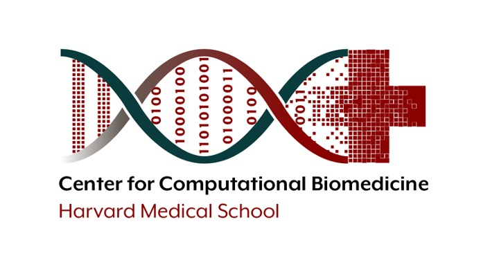
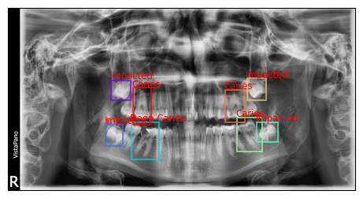
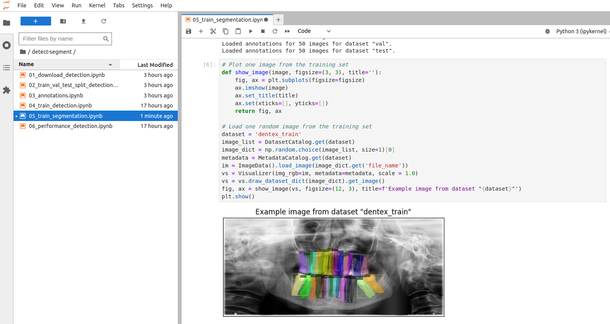
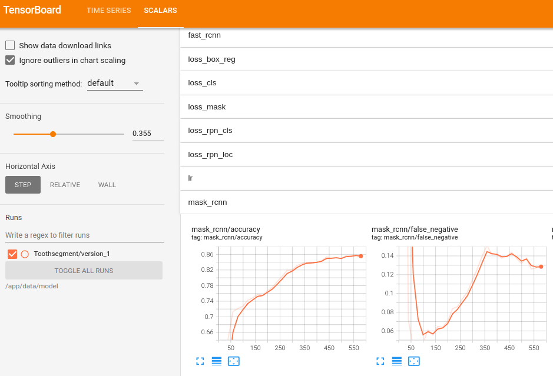
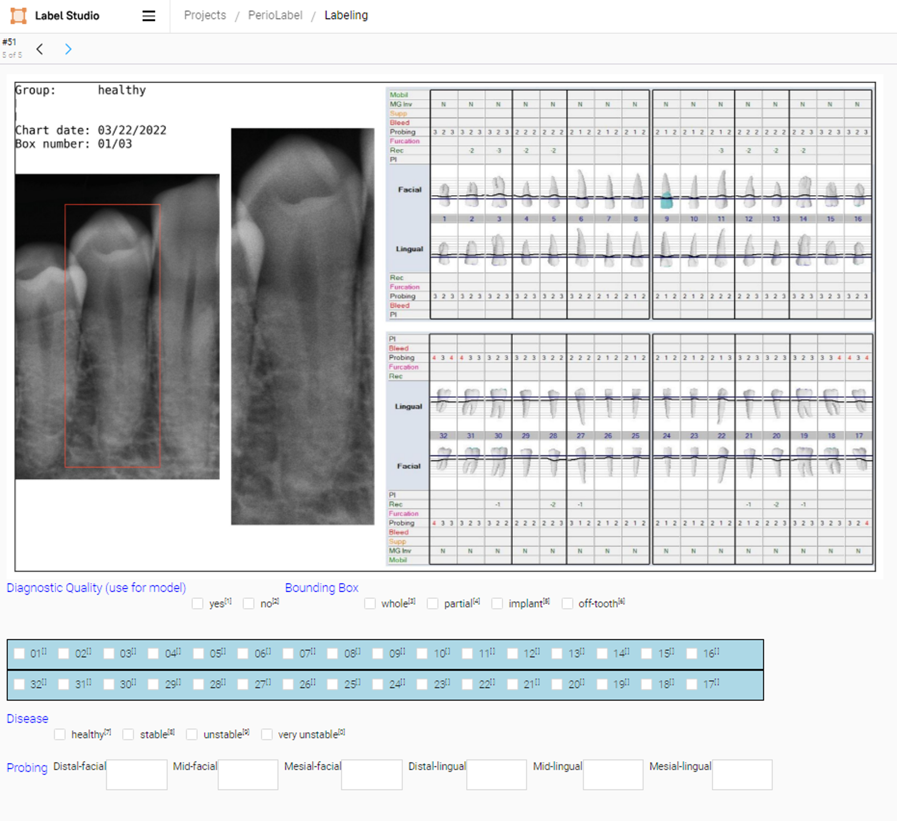

<p float="left">
    
    
</p>

## DentaMind AI

*An explainable dental radiograph analysis system with uncertainty-guided active learning and evidence-grounded generative AI.*
Research prototype - nothing it produces is a diagnosis. Every generated report is an **unconfirmed research draft** until a named reviewer signs it off.

The research code of this repository (below) is unchanged. DentaMind adds `src/dentexmodel/` (core library), `backend/` (FastAPI), `frontend/` (React/Vite), `configs/`, `scripts/` and `tests/`.

### Current status (measured 2026-10-14)

| | |
|---|---|
| **Dataset** | DENTEX is present in `Data/training_data/` (`quadrant`, `quadrant_enumeration`, `quadrant-enumeration-disease`, `unlabelled`) plus 50 unlabeled images in `Data/validation_data/`. 3,653 PNG files, 0 corrupt, but only **2,716 distinct radiographs** and **1,133 distinct annotated radiographs**: the sub-sets overlap. See [docs/DATASET_GUIDE.md](docs/DATASET_GUIDE.md) and `Data/reports/dataset_audit.md`. |
| **Splits** | Grouped by pixel content, so one radiograph never crosses splits (train 794 / val 113 / calibration 113 / test 113 distinct radiographs). The test split is locked; unlabeled `validation_data` is held out as test data. |
| **Trained models** | Tooth detector (Faster R-CNN), finding classifier (ResNet-50), tooth instance segmenter (Mask R-CNN) - checkpoints and sidecars in `Data/checkpoints/`, measured results in `Data/reports/eval_*.md`. See [docs/MODEL_TRAINING.md](docs/MODEL_TRAINING.md) for the numbers and what they do **not** show. |
| **Active learning** | Measured on the finding task: entropy selection did **not** beat random sampling (`Data/reports/active_learning_experiment.md`). |
| **Tooth numbering** | `dentex_fdi_numbering_v1` (FDI, 32 teeth): test exact accuracy 0.968 among localised teeth, 0.938 strict; registered only after passing its validation gate. |
| **Uncertainty and review** | Full pipeline with per-region ids, four uncertainty signals (entropy, flip disagreement, mask/detection instability from flip passes), abstention on high-entropy regions, in-app region review with audit history, pool scoring for uncertainty-guided active learning. Thresholds are provisional. See [docs/UNCERTAINTY_AND_ACTIVE_LEARNING.md](docs/UNCERTAINTY_AND_ACTIVE_LEARNING.md), [docs/PROJECT_AUDIT.md](docs/PROJECT_AUDIT.md), [docs/DEMO_SCRIPT.md](docs/DEMO_SCRIPT.md). |
| **Reports** | English, Hindi and Marathi written reports from validated structured outputs (local templates, no external API); see [docs/MULTILINGUAL_REPORTS.md](docs/MULTILINGUAL_REPORTS.md). Hindi/Marathi wording awaits native dental review. |
| **Not claimed** | No clinical validation. The classifier has no "healthy" class. See [docs/KNOWN_LIMITATIONS.md](docs/KNOWN_LIMITATIONS.md). |

Docs: [Windows setup](docs/WINDOWS_SETUP.md) - [dataset](docs/DATASET_GUIDE.md) - [training and evaluation](docs/MODEL_TRAINING.md) - [API](docs/API_GUIDE.md) - [limitations](docs/KNOWN_LIMITATIONS.md).

### Run the pipeline and the models

```powershell
cd "D:\Dentex-Gen Ai"
.\.venv\Scripts\python.exe scripts\run_pipeline.py --force        # discover -> validate -> manifest -> grouped splits -> quality stats
.\.venv\Scripts\python.exe scripts\audit_dataset.py               # Data\reports\dataset_audit.json / .md
.\.venv\Scripts\python.exe scripts\train_model.py --task detection --name dentex_teeth --epochs 12 --batch-size 2 --lr 1e-4
.\.venv\Scripts\python.exe scripts\train_model.py --task classification --architecture resnet50 --name dentex_findings --epochs 15 --batch-size 32 --lr 3e-4
.\.venv\Scripts\python.exe scripts\train_model.py --task segmentation --name dentex_teeth --epochs 8 --batch-size 1 --lr 1e-4
.\.venv\Scripts\python.exe scripts\evaluate_model.py --checkpoint dentex_teeth_detection_v1.pth --split val
.\.venv\Scripts\python.exe scripts\predict.py --image Data\validation_data\quadrant_enumeration_disease\xrays\val_3.png
.\.venv\Scripts\python.exe scripts\run_al_experiment.py --seeds 0 1 2
.\.venv\Scripts\python.exe -m unittest discover -s tests
```

Training logs: `logs\job-*.log` (and TensorBoard event files under `Data\runs\<job>` if TensorBoard is installed). Train one model at a time on a 4 GB GPU.

### Run the application

> **Simplified interface.** The sidebar shows Home, X-ray Analysis, Reports and Review Findings (plus About and Settings). Research and developer pages (Segmentation, Uncertainty, Active Learning, Annotations, Model Training, Experiments, Model Registry) still exist: switch them on in Settings -> "Show Research / Developer Tools". See [docs/UI_SIMPLIFICATION_REPORT.md](docs/UI_SIMPLIFICATION_REPORT.md).

> **API token.** The API requires a token on every route except `/api/health`. It is created on first start in `runtime/api_token.txt` (git-ignored); the Vite proxy adds it for the UI, `check_running.ps1` and the audit scripts read it themselves. For manual calls send `Authorization: Bearer <token>` (see [docs/API_GUIDE.md](docs/API_GUIDE.md)).

**Windows (PowerShell)** - full guide, ports, environment variables and HTTP 403 troubleshooting: [docs/WINDOWS_SETUP.md](docs/WINDOWS_SETUP.md).

```powershell
cd "D:\Dentex-Gen Ai"
powershell -ExecutionPolicy Bypass -File scripts\windows\setup.ps1        # venv + requirements-api.txt + npm install (skips what is installed)
powershell -ExecutionPolicy Bypass -File scripts\windows\start_all.ps1    # backend :8000 and frontend :5173 in two windows, then checks
powershell -ExecutionPolicy Bypass -File scripts\windows\check_running.ps1  # re-run the checks at any time
```

Linux/macOS:

```bash
pip install -r requirements-api.txt
python -m uvicorn backend.main:app --host 127.0.0.1 --port 8000   # API docs at http://127.0.0.1:8000/docs
cd frontend && npm install && npm run dev                          # UI at http://localhost:5173 (proxies /api to 127.0.0.1:8000)
```

Training and inference additionally need PyTorch (`pip install -r requirements-ml.txt`, choose the CUDA build for your driver) and a dental checkpoint with a `.json` metadata sidecar in `data/checkpoints/`. Docker: `docker compose -f docker-compose.dentamind.yml up --build` (profiles `annotation` for Label Studio and `training` for TensorBoard). The dataset is mounted, never baked into an image.

### Configuration

All paths are relative to the project root or taken from `.env` (see `.env.example`); there are no absolute paths in the code and everything uses `pathlib`. Secrets (`LABEL_STUDIO_API_KEY`, `LLM_API_KEY`) are read from the environment only and are never returned by the API or shown in the UI. Model and dataset settings live in `configs/*.yaml`. Reports use a deterministic template unless an OpenAI-compatible LLM is configured; LLM output is validated against the structured evidence and falls back to the template if it fails.

### Verification status

A full functionality audit was run on 2026-10-14 against the **real** servers (uvicorn :8000, Vite :5173) on this Windows machine (Python 3.13, PyTorch 2.6+cu124, RTX 3050 4 GB): 205 unit/integration tests, 138 live API checks, per-model inference checks on real radiographs (including missing-/tampered-checkpoint and CPU-only runs), 61 multilingual-report checks, 23 live security checks, 20 real API-started smoke-training checks, a 39-check browser audit and a 27-step review workflow in headless Edge. Verdict: **DEMO READY for a local research demonstration** - not production ready and not clinically validated. The audits found and fixed 24 defects (for example a Reports-page crash, unguarded concurrent GPU evaluations, an unverified checkpoint-hash gap, a cancelled job registering a checkpoint) and added token authentication and rate limiting; remaining items are in [docs/REMAINING_ISSUES.md](docs/REMAINING_ISSUES.md).
Start here: [docs/FINAL_ACCEPTANCE_REPORT.md](docs/FINAL_ACCEPTANCE_REPORT.md) (verdict, metrics, demo script), [docs/FUNCTIONALITY_AUDIT.md](docs/FUNCTIONALITY_AUDIT.md) (60-feature inventory and defect register), [docs/END_TO_END_TEST_REPORT.md](docs/END_TO_END_TEST_REPORT.md), [docs/MULTILINGUAL_REPORT_TEST_REPORT.md](docs/MULTILINGUAL_REPORT_TEST_REPORT.md), [docs/RESEARCH_TOOLS_VALIDATION.md](docs/RESEARCH_TOOLS_VALIDATION.md), [docs/SECURITY_AND_DEPLOYMENT_AUDIT.md](docs/SECURITY_AND_DEPLOYMENT_AUDIT.md), [docs/TEST_EXECUTION_LOG.md](docs/TEST_EXECUTION_LOG.md). Re-run the suite with `powershell -NoProfile -File scripts
un_audit_suite.ps1` (servers must be running).
**Not verified:** a live Label Studio, a live LLM, TensorBoard (not installed), Docker, `scripts\windows\setup.ps1` and `start_all.ps1` (the other Windows scripts were run). The Hindi and Marathi report wording has not been reviewed by a native-speaking dental professional. Detailed results and caveats: [docs/MODEL_TRAINING.md](docs/MODEL_TRAINING.md), [docs/KNOWN_LIMITATIONS.md](docs/KNOWN_LIMITATIONS.md).

## The CCB Computer Vision Code Repository #

This repository contains template code that that can be used as 
a starting point for computer vision projects. 
All frameworks, libraries and data sets are open source and publicly available.
Some common tasks included here are:

- [Image Classification](./notebooks/classification)
- [Object Detection](./notebooks/detect-segment)
- [Instance Segmentation](./notebooks/detect-segment)
- [Gradient-weighted Class Activation Mapping](./notebooks/classification/10_explainable_ai.ipynb)

## The Dentex Challenge 2023

The Dentex Challenge 2023 aims to provide insights into the effectiveness of AI in 
dental radiology analysis and its potential to improve dental practice by comparing 
frameworks that simultaneously point out abnormal teeth with dental enumeration and 
associated diagnosis on panoramic dental X-rays.
The dataset comprises panoramic dental X-rays obtained from three 
different institutions using standard clinical conditions but varying equipment and imaging protocols, 
resulting in diverse image quality reflecting heterogeneous clinical practice. 
It includes X-rays from patients aged 12 and above, 
randomly selected from the hospital's database to ensure patient privacy and confidentiality.
A detailed description of the data and the annotation protocol 
can be found on the [Dentex Challenge](https://dentex.grand-challenge.org/) website.
The data set is publicly available for download from the [Zenodo](https://zenodo.org/records/7812323#.ZDQE1uxBwUG) 
open-access data repository.

## Install locally with Docker
The most convenient way to get started with this repository is to run the 
code examples in a [Docker](https://docs.docker.com/) container.

The Dockerfile and docker-compose.yml files included in the repository can be 
used to create a Docker image and run a Docker container, which together provide a 
reproducible Python development environment for computer
vision experimentation. This environment includes Ubuntu 22.04, Python 3.10.12, PyTorch 2.2 and
Tensorflow 2.15 with NVIDIA CUDA 12.1, and a Jupyter Lab server, making it 
well-suited for training and evaluating custom models. 

<p float="left">
    
    
</p>

Here's a step-by-step guide on how to use this setup:

1. Install [Docker](https://docs.docker.com/) on your machine.
2. Clone the GitHub project repository to download the contents of the repository:
```bash
git clone git@github.com:ccb-hms/computervision.git
```
3. Navigate to the repository's directory: Use `cd computervision` to change your current directory to the repository's 
directory.
4. Build the Docker image. Use the command `docker compose build` to build a Docker image from the 
Dockerfile in the current directory. This image will include all the specifications from the Dockerfile, 
such as Ubuntu 22.04, Python 3.10.12, PyTorch 2.2 and TensorFlow 2.15 with CUDA, and a Jupyter Lab server.
5. Run `docker compose up` to start the Docker container based on the configurations 
in the docker-compose.yml file. This will also download a [TensorFlow 2](https://www.tensorflow.org/) image 
with the [TensorBoard](https://www.tensorflow.org/tensorboard) server for tracking and visualizing
important metrics such as loss and accuracy.
The default `docker-compose.yml`file expects a GPU accelerator and the NVIDIA Container Toolkit installed on the local machine.
Without a GPU, training of the neural networks in the example notebooks will be extremely slow. 
However, with the following command, the containers can be run without GPU support:
```bash
docker compose -f docker-compose-cpu.yml up
```
6. Access Jupyter Lab: Click on the link that starts with `localhost:8888` provided by the 
output of the last command.
7. Access TensorBoard: Open a web browser and go to localhost:6006 to access the TensorBoard server.
Real-time visualizations of important metrics will show up once model training is started.
8. Data sets and model checkpoints use a `./data` folder inside the root of the repository.
The location and the name of this directory are defined by the environmental variable `DATA_ROOT`.

### GPU support for Docker ###

The NVIDIA Container Toolkit is a set of tools designed to enable GPU-accelerated applications to run within Docker containers. 
This toolkit facilitates the integration of NVIDIA GPUs with container runtimes, 
allowing developers and data scientists to harness the power of GPU computing in containerized environments.
See the [NVIDIA Container Toolkit](https://docs.nvidia.com/datacenter/cloud-native/container-toolkit/latest/install-guide.html) page for installation instructions.

### Install without Docker ###

If you are using the Docker environment, you should be good to go.
For installation in a local environment we use 
[pipenv](https://pipenv.readthedocs.io/en/latest/) to provide a pure, repeatable, application environment.
Mac/windows users should [install pipenv](https://pipenv.readthedocs.io/en/latest/#install-pipenv-today) into
their main python environment as instructed. 
Pipenv is a packaging tool for Python that solves some common problems 
associated with the typical workflow using pip, virtualenv, and the good old requirements.txt. 
It combines the functionalities of pip and virtualenv into one tool, 
providing a smooth and convenient workflow for developers.

With Pipenv, project dependencies and the virtual environment can be managed easily. 
It uses a Pipfile and Pipfile.lock to keep track of project dependencies with 
package versions, similar to how package.json works in Node.js projects or Gemfile in Ruby.

```bash
# Create a pipenv environment with all dependencies
pipenv install -e . --dev
# Run jupyter lab
pipenv run jupyter lab
```


Label Studio is an open-source data labeling tool for labeling, annotating, 
and exploring many different data types. 
Additionally, the tool includes a powerful machine learning interface that can be used for new model training, 
active learning, supervised learning, and many other training techniques.

1. Multi-type annotations: Label Studio supports multiple types of annotations, including labeling for audio, video, images, text, and time series data. These annotations can be used for tasks such as object detection, semantic segmentation, and text classification among others.
2. Customizable: The label interface can be customized using a configuration API.



3. Machine Learning backend: Label Studio allows integration with machine learning models. You can pre-label data using model predictions and then manually adjust the results.
4. Data Import and Export: Label Studio supports various data sources for import and export. You can import data from Amazon S3, Google Cloud Storage, or a local file system, and export it in popular formats like COCO, Pascal VOC, or YOLO.
5. Collaboration: It supports multiple users, making it suitable for collaborative projects.
6. Scalability: Label Studio can be deployed in any environment, be it on a local machine or in a distributed setting, making it a scalable solution.

### How to Use Label Studio

The tool is included in this repository as a [submodule](https://git-scm.com/book/en/v2/Git-Tools-Submodules).
When you clone the main project, by default the directory that contains the submodule is included,
but without the files. Those can be installed when needed:
```bash
# Clone the main project if not already done
git clone git@github.com:ccb-hms/computervision.git
# CD into the computervision/label-studio directory 
cd computervision/label-studio
# Download the latest version 
git submodule init
git submodule update
```
Label studio can be run as a server application in a docker container. The process is the same as
described above for the main repository.
```bash
# CD into the computervision/label-studio directory 
cd computervision/label-studio
# Create the Label Studio image 
docker compose build
# Run the Label Studio server
docker compose up
```
Once installed, open a web browser and go to localhost:8080 to access the Label Studio server.
For more detailed installation instructions, 
see the [installation instructions](https://labelstud.io/guide/install).